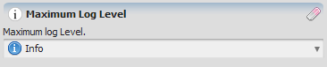


# Log Tag Type

**Log Tag** is a value representing a log level.

### Log Level

The main log level ("Tools => Options \| General \| Main Log") controls what is displayed in the GUI Message Log and what is written to the files `debug.txt` and `log.txt`.

The different log levels are shown below:

| Level | Name | Description |
| --- | --- | --- |
| @cyan:0 | Unconditional | Displays basic information about the Dinamica EGO status. |
| @pink:1 | Error | Displays any error that occurred, and all the information from the levels below this. |
| @lightyellow:2 | Warning | Displays warnings regarding any potential problem that may occur, and all the information from the levels below this. |
| @lightgreen:3 | Result | Displays the result only. |
| 4 | Info | Displays progress information and all the information from the levels below this. This is the standard log level. |
| @lightblue:5 | Info 2 | Displays additional progress information and all the information from the levels below this. |
| @lightgray:6 | Debug | Displays debug information and all the information from the levels below this. |
| @lightgray:7 | Debug 2 | Displays additional debug information and all the information from the levels below this. |

The log files `debug.txt` and `log.txt` are typically located in the folder `C:\Users\<User>\Documents\Dinamica EGO 4`.

This default location can be overridden by defining an environment variable, `DINAMICA_LOG_PATH`, containing the desired log path.

## GUI Editor

The log tag editor presents a dropdown listing each log level by name.

## EGO Script

A log tag constant is written in [EGO Script](../EGO-Script.html) using the following syntax:

| Value | Representation |
| --- | --- |
| Unconditional | `.unconditional` |
| Error | `.error` |
| Warning | `.warning` |
| Result | `.result` |
| Info | `.info` |
| Info 2 | `.info2` |
| Debug | `.debug` |
| Debug 2 | `.debug2` |

## Automatic Conversions

- **Converted from**: [Real Value Type](Real-Value-Type.html), [Integer Value Type](Integer-Value-Type.html), [Non Negative Integer Value Type](Non-Negative-Integer-Value-Type.html), and [Positive Integer Value Type](Positive-Integer-Value-Type.html) — the numeric value maps to a log level by its `Level` number in the table above (e.g. `4` converts to Info).
- **Converted to**: [Real Value Type](Real-Value-Type.html), [Integer Value Type](Integer-Value-Type.html), and [Non Negative Integer Value Type](Non-Negative-Integer-Value-Type.html) — using that same `Level` number (e.g. Info → `4`). [Positive Integer Value Type](Positive-Integer-Value-Type.html) — same mapping, but can fail: Unconditional (level 0) has no valid Positive Integer representation. [String Type](String-Type.html) — converts to the level's name (e.g. `"Info"`).

See [Type System](../Type-System.html) for the complete conversion reference across all types.

