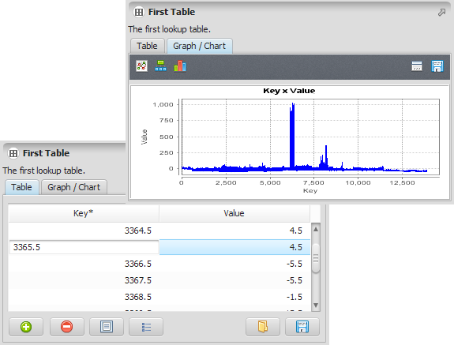


# Lookup Table Type

A lookup table is a collection of key and value pairs. Both key and value are represented using double precision [floating point numbers](https://en.wikipedia.org/wiki/Floating_point), allowing the definition of integral and fractional keys and value pairs.

Optionally, a lookup table may also include key and value names.

## GUI Editor



The editor provides some additional useful operations:

It is possible to load the editor content importing the value from a [CSV file](https://en.wikipedia.org/wiki/Comma-separated_values). It is also possible to export the content to a [CSV file](https://en.wikipedia.org/wiki/Comma-separated_values).

Two rows can be used to interpolate other rows in between. The keys are created incrementing the lower selected key until the greatest selected key is reached. The values are interpolated linearly between the two original selected values.

The table can also be presented as a graph using different representations.

## EGO Script

Lookup tables are a sequence of key/value pairs enclosed by \[ \]. The keys/values are represented by real values. See [Table Type](Table-Type.html) for the syntax rules that apply to tables in general, of which this is a specialized, Real-only case.

```
[
  1991 0.02,
  1993 0.025,
  1997 0.01,
  1999 0.05
]
```

The use of commas between elements and key/value pairs is optional. The layout can also be changed at will.

```
[ 1991 0.02 1993 0.025 1997 0.01 1999 0.05 ]
```

Optionally, the first two elements may define the key/value names, always in this order:

| Part | Required? | Meaning |
| --- | --- | --- |
| Key name | No — must be given together with the value name, or not at all | Names the key column. May be suffixed with `*`, matching Table Type's key-column convention, though with only one key column there is nothing to disambiguate. Defaults to `Key` if omitted. |
| Value name | No — must be given together with the key name, or not at all | Names the value column. Defaults to `Value` if omitted. |

Blanks in names are automatically replaced by "\_" (underscore).

```
[
  "Year" "Transition Rate",
  1991 0.02,
  1993 0.025,
  1997 0.01,
  1999 0.05
]
```

Here the key column is named `Year` and the value column `Transition Rate`; omitting both would fall back to the defaults `Key` and `Value`.

Again, the table layout is not relevant.

```
[ "Year" "Transition Rate" 1991 0.02 1993 0.025 1997 0.01 1999 0.05 ]
```

Key/value sequences can be defined using the operator `..` (two consecutive dots). This is the same interpolation described under *GUI Editor* above, expressed in text instead of by selecting two rows. This operator forces the values between the given pair of entries to be automatically generated. Keys are generated by incrementing the initial sequence key by one until the final sequence key is reached. Values are generated by interpolating the corresponding values across the key range.

```
[
 "X" "Y",
 1.0 4.0,
 1.3 12.0,
 1.7 5.0 .. 7.3 8.5
]
```

The previous table is automatically expanded to

```
[
 "X" "Y",
 1.0 4.0,
 1.3 12.0,
 1.7 5.0,
 2.0 5.5,
 3.0 6.0,
 4.0 6.5,
 5.0 7.0,
 6.0 7.5,
 7.0 8.0,
 7.3 8.5
]
```

It is possible to use more than one sequence definition in a given table.

```
[
  "Year" "Transition Rate",
  1991 0.02,
  1993 0.025,
  1997 0.01 .. 1999 0.05,
  2004 0.02 .. 2010 0.025,
]
```

When a script is saved, the lookup tables are automatically collapsed using the `..` notation, if possible.

## Automatic Conversions

- **Converted from**: [Table Type](Table-Type.html) (only if the table has exactly the columns `*#real` and `#real`), [Base Table Type](Base-Table-Type.html), [Lookup Table Group Type](Lookup-Table-Group-Type.html), [Change Matrix Type](Change-Matrix-Type.html), [Transition Matrix Type](Transition-Matrix-Type.html), and [Percent Matrix Type](Percent-Matrix-Type.html).
- **Converted to**: [Base Table Type](Base-Table-Type.html) — this is **subtyping**: a Lookup Table is already, structurally, a Base Table, so no conversion logic runs. [Table Type](Table-Type.html), [Lookup Table Group Type](Lookup-Table-Group-Type.html), [Change Matrix Type](Change-Matrix-Type.html), [Transition Matrix Type](Transition-Matrix-Type.html), [Percent Matrix Type](Percent-Matrix-Type.html), [Transition Set Type](Transition-Set-Type.html), and [Int Set Type](Int-Set-Type.html).

See [Type System](../Type-System.html) for the complete conversion reference across all types.

