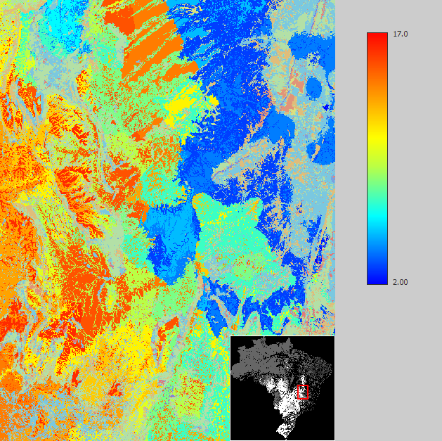


# Map Type

A **Map** represents a grid of cells — with a fixed number of lines and columns — associated with a map projection, datum, and registration coordinates that anchor the grid in real-world space, along with a cell size defining the grid resolution. A Map can optionally define a null value, and can optionally hold more than one named layer, each layer being its own independent raster sharing the same dimensions and geographic format (see [Create Cube Map](../functors/Create-Cube-Map.html) and [Extract Map Layer](../functors/Extract-Map-Layer.html)).

There are two basic kinds of maps:

## Categorical Maps

Maps whose cells represent classes or categories — vegetation type, soil type, sub-regions, and similar. A map becomes a Categorical Map when a [Categorization](Categorization-Type.html) is attached to it, associating its integer cell values with category names and colors.


## Non-Categorical Maps

Maps whose cells represent values — temperature, probabilities, distances, and similar. A Non-Categorical Map carries no Categorization.



## GUI Editor

Input [ports](../EGO-Script.html#ports) of type Map are non-editable, so a map cannot be defined using an editor in the graphical interface. A Map value must always come from connecting an output produced by another functor — a loader such as [Load Map](../functors/Load-Map.html), or a calculator such as [Calculate Map](../functors/Calculate-Map.html) — supplied by wiring that output to the input.

## EGO Script

For the same reason, input [ports](../EGO-Script.html#ports) of type Map cannot receive a constant in [EGO Script](../EGO-Script.html) — see [Constants](../EGO-Script.html#constants). A Map is always obtained by calling a functor that produces one, and reused by referencing the variable bound to its output. The filename passed to a loader such as [Load Map](../functors/Load-Map.html) is itself a [Map Filename](Map-Filename-Type.html) constant — an ordinary quoted string, validated against the expected extension:

```
// Loads a map, computes its slope, and saves the result.
elevation := LoadMap "c:/data/elevation.tif";
slope := CalcSlopeMap elevation;
SaveMap slope "c:/data/slope.tif";
```

The generic [Map](../functors/Map.html) carrier functor exists purely to pass a Map connection through — for example, as a placeholder while wiring a model — but its own input is likewise non-editable; it must itself be connected to another functor's Map output.

## Storage

How a map's cells are actually kept — fully in memory, as a sparse mapping of only non-null cells, or paged from disk on demand — is a storage detail separate from the map's content, and never changes the map's values. Depending on the functor producing the map, this can be controlled explicitly or left for the runtime to decide:

- **Loaders** such as [Load Map](../functors/Load-Map.html) and [Load Categorical Map](../functors/Load-Categorical-Map.html) expose a `storageMode` input — an [Enum Type](Enum-Type.html) port — offering the full range of choices: `.default` (use the global memory allocation policy), `.preferMemory` (load fully into memory), `.preferDisk` (page from disk on demand), or `.loadAsSparse` (store only non-null cells).
- **Most functors that create or calculate a map** — such as [Create Map](../functors/Create-Map.html), [Create Categorical Map](../functors/Create-Categorical-Map.html), [Calculate Map](../functors/Calculate-Map.html), and [Calc Slope Map](../functors/Calc-Slope-Map.html) — expose a simpler Boolean flag that forces the output to be stored as sparse when true, or fully in memory when false. The flag's name varies by functor (`createAsSparse`, `resultIsSparse`, `slopeIsSparse`, and similar). Since these functors compute their map's cells directly rather than reading them from an existing file, they have no on-disk paging option — that only applies to a map already backed by a file, as with the loaders above.
- When a functor exposes no storage-related input at all, the runtime chooses the storage strategy automatically — the same choice `.default` makes for a loaded map.

## Automatic Conversions

- **Converted from**: [Categorical Map Type](Categorical-Map-Type.html) — this is **subtyping**, not a registered conversion: a Categorical Map is already, structurally, a Map, so no conversion logic actually runs. Its cell values, null value, and categorization all carry over untouched; only the guarantee that a categorization is present is dropped, since a plain Map's categorization is optional. The reverse does not happen automatically: a plain Map is not accepted where a Categorical Map is required, since that guarantee can't be manufactured from nothing.
- **Converted to**: [Projection Type](Projection-Type.html).

See [Type System](../Type-System.html) for the complete conversion reference across all types, including which conversions are subtyping versus registered converters.

