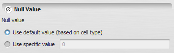


# Null Value Type

A null value denotes the value that should be used to represent "no data" in a [Map](Map-Type.html) or [Categorical Map](Categorical-Map-Type.html). This value is related to the [cell type](Cell-Type.html) used to represent the map's cells.

## GUI Editor

The null value editor lets you select the default null value for the current cell type, or specify one explicitly.

## EGO Script

A null value constant is written in [EGO Script](../EGO-Script.html) using the following syntax:

| Description | Representation |
| --- | --- |
| The default null value for the current [Cell Type](Cell-Type.html) | `.default` |
| A specified null value | [Real Value Type](Real-Value-Type.html) constant |

## Automatic Conversions

- **Converted from**: [Real Value Type](Real-Value-Type.html), [Integer Value Type](Integer-Value-Type.html), [Non Negative Integer Value Type](Non-Negative-Integer-Value-Type.html), [Positive Integer Value Type](Positive-Integer-Value-Type.html), and [Boolean Value Type](Boolean-Value-Type.html).
- **Converted to**: None.

See [Type System](../Type-System.html) for the complete conversion reference across all types.

