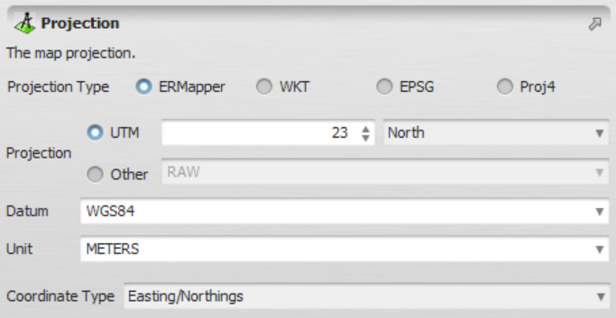


# Projection Type

Represents a [map projection](https://en.wikipedia.org/wiki/Map_projection): the mathematical transformation used to represent locations on the Earth's curved surface as coordinates on a flat plane. Every projection is tied to a coordinate reference system (CRS), which combines a datum, an ellipsoid (or sphere) model of the Earth, the projection method itself, and a unit of measurement. The projection assigned to a map determines how its coordinates are interpreted and how it aligns with other spatial data.

Projections can be defined in one of four ways:

- Using the **predefined options** (UTM, Geodetic, etc.) — a curated list of common projections that can be selected directly, without specifying any further parameters.
- Using a **WKT specification** — a complete, self-contained description of the CRS.
- Using an **EPSG code** — a numeric identifier looked up in the [EPSG Geodetic Parameter Registry](https://epsg.org/search/by-name).
- Using a **Proj4 specification** — a compact, parameter-based string.

WKT specifications must follow the [WKT standard syntax](https://docs.ogc.org/is/18-010r7/18-010r7.html). A WKT description fully defines the CRS — datum, spheroid, prime meridian, angular/linear units, projection method and its parameters — which makes it the most explicit and portable of the four ways to specify a projection. See the example below:

```
PROJCS["SUTM21",
    GEOGCS["SOUTH AMERICAN 1969",
        DATUM["SAD69",
            SPHEROID["INT67",6378160,298.25]],
        PRIMEM["Greenwich",0],
        UNIT["degree",0.0174532925199433]],
    PROJECTION["Transverse_Mercator"],
    PARAMETER["latitude_of_origin",0],
    PARAMETER["central_meridian",-57],
    PARAMETER["scale_factor",0.9996],
    PARAMETER["false_easting",500000],
    PARAMETER["false_northing",10000000],
    UNIT["Meter",1]]
```

The Proj4 syntax must also follow the [Proj4 specification syntax](https://proj4.org/en/5.2/usage/index.html). Rather than the nested structure of WKT, Proj4 represents a CRS as a list of `+key=value` flags, which tends to be more compact and faster to write by hand. Example:

```
+proj=latlong +ellps=GRS80 +towgs84=-199.87,74.79,246.62
```

## GUI Editor



The projection editor lets you select and configure a projection using any of the four definition methods described above.

## EGO Script

A constant representing a projection in an [EGO Script](../EGO-Script.html) can be defined in four different ways:

### Using ERMapper parameters

This form specifies the coordinate type together with three keywords — projection, datum and unit — following the naming conventions used by ER Mapper.

```
[| "COORDINATE_TYPE", "ERMAPPER_PROJECTION", "ERMAPPER_DATUM", "ERMAPPER_UNIT" |]
```

All parameters are case-insensitive and must be surrounded by double quotes.

Example:

```
[| "LATLONG", "GEODETIC", "WGS84", "METERS" |]
```

### Using a WKT (Well-Known Text) description

This form embeds a full WKT description directly in the script, giving complete control over every CRS parameter.

```
[| "COORDINATE_TYPE", WKT_PROJECTION |]
```

The syntax used to represent the WKT_PROJECTION can be found [here](https://docs.ogc.org/is/18-010r7/18-010r7.html). It is worth noting that only the COORDINATE_TYPE must be surrounded by double quotes.

Example:

```
[| "LATLONG",
   PROJCS["unnamed",
       GEOGCS["WGS 84",
           DATUM["WGS_1984",
               SPHEROID["WGS 84",6378137,298.257223563,
                   AUTHORITY["EPSG","7030"]],
               TOWGS84[0,0,0,0,0,0,0],
               AUTHORITY["EPSG","6326"]],
           PRIMEM["Greenwich",0,
               AUTHORITY["EPSG","8901"]],
           UNIT["degree",0.0174532925199433,
               AUTHORITY["EPSG","9108"]],
           AUTHORITY["EPSG","4326"]],
       PROJECTION["Transverse_Mercator"],
       PARAMETER["latitude_of_origin",0],
       PARAMETER["central_meridian",90],
       PARAMETER["scale_factor",0.9996],
       PARAMETER["false_easting",500000],
       PARAMETER["false_northing",-2000000],
       UNIT["METERS",1]]]
|]
```

### Using a Proj4 description

This form embeds a Proj4 parameter string, enclosed in square brackets, in place of the WKT description.

```
[| "COORDINATE_TYPE", [ PROJ4_PROJECTION ] |]
```

The syntax used to represent the PROJ4_PROJECTION can be found [here](https://proj4.org/en/5.2/usage/index.html).

Example:

```
[| "LATLONG",
   [ +proj=longlat +ellps=WGS84 +towgs84=0,0,0,0,0,0,0 +no_defs ]
|]
```

### Using an EPSG code

This form looks up the projection directly from its numeric [EPSG](https://epsg.org/search/by-name) identifier, making it the most compact of the four options.

```
[| "COORDINATE_TYPE", EPSG_CODE |]
```

Example:

```
[| "LATLONG",
   7030
|]
```

---

A COORDINATE_TYPE is also case-insensitive and must be one of the following keywords:

| Keyword | Description |
| --- | --- |
| `en` | Easting/Northing (projected/planar coordinates) |
| `latlong` | Latitude/Longitude (geographic coordinates) |
| `none` | Automatically derive the coordinate type from the projection parameters |

## Automatic Conversions

- **Converted from**: [Map Type](Map-Type.html) and [Categorical Map Type](Categorical-Map-Type.html) — either kind of map converts directly to its own projection. [String Type](String-Type.html).
- **Converted to**: [String Type](String-Type.html). Projection Type is one of only three types that connect exclusively to String Type rather than the broader Table Value Type family other filenames and text-like types also reach — see [Table Value Type](Table-Value-Type.html) on the [Type System](../Type-System.html) page for that distinction.

See [Type System](../Type-System.html) for the complete conversion reference across all types.

