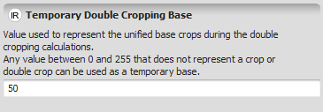


# Real Value Type

A [real number](https://en.wikipedia.org/wiki/Real_number) denotes all fractional and non-fractional values.

This value is defined as a [double precision floating point number](https://en.wikipedia.org/wiki/Double_precision_floating-point_format), according to the IEEE754 standard.

## GUI Editor

## EGO Script

Real values in Dinamica EGO use the standard representation for floating point numbers.

- 1, 2, 198, etc.
- -1, -2, -198, etc.
- -1.002, -2321.3441, -198.4455, etc.
- 5.45e-32, -34.211e+45, etc. (Syntax MeE, where M is a mantissa and E is the exponent. It denotes M\*10E)

## Automatic Conversions

- **Converted from**: [Integer Value Type](Integer-Value-Type.html) — lossless; widening, every integer is exactly representable as a real. [Non Negative Integer Value Type](Non-Negative-Integer-Value-Type.html). [Positive Integer Value Type](Positive-Integer-Value-Type.html). [Boolean Value Type](Boolean-Value-Type.html) — True → 1, False → 0. [Index Or Name Type](Index-Or-Name-Type.html) — can fail; only succeeds if the value holds an index rather than a name. [String Type](String-Type.html) — can fail; the string must parse as a valid number (e.g. `"test"` fails, `"3.14"` succeeds). [Log Tag Type](Log-Tag-Type.html) — converts to the level's number (e.g. Info → 4). [Cell Type](Cell-Type.html) — converts to the cell type's number (e.g. Signed 32 Bit Integer → 5). [Table Value Type](Table-Value-Type.html) — can fail; only succeeds if the value actually holds a Real Value.
- **Converted to**: [Boolean Value Type](Boolean-Value-Type.html) — zero → False, any non-zero value → True. [Enum Type](Enum-Type.html). [Index Or Name Type](Index-Or-Name-Type.html). [Integer Value Type](Integer-Value-Type.html) — lossy; truncates the fractional part. [Non Negative Integer Value Type](Non-Negative-Integer-Value-Type.html) — can fail on negative input; lossy (truncates) otherwise. [Positive Integer Value Type](Positive-Integer-Value-Type.html) — can fail when not positive; lossy (truncates) otherwise. [Null Value Type](Null-Value-Type.html). [Log Tag Type](Log-Tag-Type.html) — the number selects the level by its position in Log Tag Type's table (e.g. 4 → Info). [Cell Type](Cell-Type.html) — the number selects the cell type by its position in Cell Type's table (e.g. 5 → Signed 32 Bit Integer). [Percent Type](Percent-Type.html). [String Type](String-Type.html). [Date Type](Date-Type.html). [Table Cell Type](Table-Cell-Type.html). [Table Value Type](Table-Value-Type.html). [Tuple Type](Tuple-Type.html).

See [Type System](../Type-System.html) for the complete conversion reference across all types.

