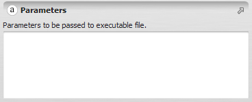


# String Type

A [string](https://en.wikipedia.org/wiki/String_(computer_science)) is a sequence of arbitrary characters.

## GUI Editor



The string editor presents a text field where the string's characters can be typed directly.

## EGO Script

### Legacy

Strings are sequences of any characters enclosed in double quotes (`"`):

```
"Amazon"
"North"
"This is an example of string"
"landscape_123       "
"x1_and_a_name"
"string with \"double quotes\""
```

A string can be any length, and can span multiple lines without any special line-break syntax:

```
"This is an example of a very long string
with multiple lines.
Note that line breaks do not need to be marked using any special syntax."
```

### Raw String Format (starting on Dinamica 5.0.1)

A raw string uses the following syntax:

```
$"<delimiter>( raw_characters )<delimiter>"
```

Where `raw_characters` is the string's content — any sequence of characters — and `<delimiter>` is any character that, together with the closing parenthesis `)`, does not appear inside `raw_characters`. The delimiter can be omitted entirely if the closing parenthesis alone doesn't appear in the content.

```
$"(This is an example of String)"
$"0(This is an example of String with the character ))0"
$"1(This is an example of String with the sequence of characters )0)1"
```

A raw string can also be any length and span multiple lines, with no special line-break syntax needed:

```
$"(This is an example of a very long string
with multiple lines.
Note that line breaks do not need to be marked using any special syntax.)"
```

## Automatic Conversions

- **Converted from**: [Boolean Value Type](Boolean-Value-Type.html), [Code Type](Code-Type.html), [Index Or Name Type](Index-Or-Name-Type.html), [Integer Value Type](Integer-Value-Type.html), [Log Tag Type](Log-Tag-Type.html), [Name Type](Name-Type.html), [Non Negative Integer Value Type](Non-Negative-Integer-Value-Type.html), [Positive Integer Value Type](Positive-Integer-Value-Type.html), [Real Value Type](Real-Value-Type.html), [Folder Type](Folder-Type.html), [Generic Filename Type](Generic-Filename-Type.html), [Map Filename Type](Map-Filename-Type.html), [Table Filename Type](Table-Filename-Type.html), [Lookup Table Filename Type](Lookup-Table-Filename-Type.html), [Weights Filename Type](Weights-Filename-Type.html), [Kmz Filename Type](Kmz-Filename-Type.html), [Projection Type](Projection-Type.html), [Elevation Graph Type](Elevation-Graph-Type.html), and [Table Value Type](Table-Value-Type.html) — the last can fail: it only succeeds if the Table Value Type actually holds a String.
- **Converted to**: [Code Type](Code-Type.html), [Date Type](Date-Type.html), [Index Or Name Type](Index-Or-Name-Type.html), [Name Type](Name-Type.html), [Folder Type](Folder-Type.html), [Generic Filename Type](Generic-Filename-Type.html), [Map Filename Type](Map-Filename-Type.html), [Table Filename Type](Table-Filename-Type.html), [Lookup Table Filename Type](Lookup-Table-Filename-Type.html), [Weights Filename Type](Weights-Filename-Type.html), [Kmz Filename Type](Kmz-Filename-Type.html), [Projection Type](Projection-Type.html), [Table Value Type](Table-Value-Type.html), and [Tuple Type](Tuple-Type.html). [Real Value Type](Real-Value-Type.html) — can fail; the string must parse as a valid number (e.g. `"test"` fails, `"3.14"` succeeds).

See [Type System](../Type-System.html) for the complete conversion reference across all types.

