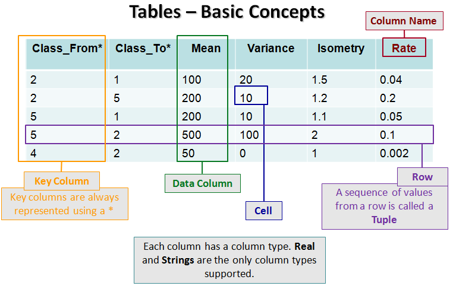
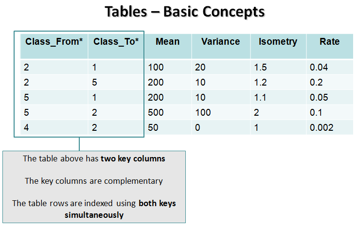
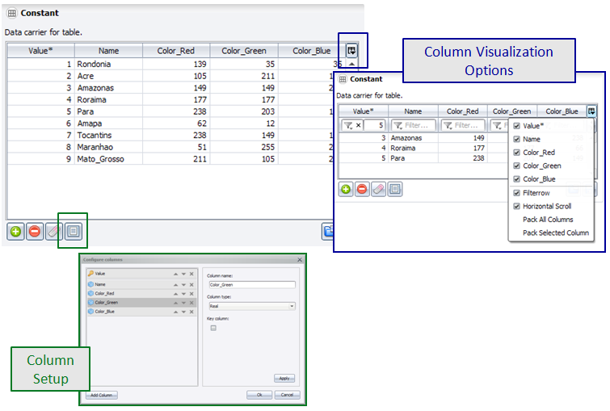


# Table Type

A table is a collection of [tuples](https://en.wikipedia.org/wiki/Tuple) organized in a special way, where each tuple may be formed by several keys and values. The set of keys in each row must be unique.





The set of all elements at the same position in all rows defines a column. All columns must have a unique name. The names must follow the general name convention in Dinamica EGO, they must start with a "\_" or a letter and must be formed by letters, numbers and underscores. Blanks in names are automatically replaced by "\_" (underscore).

Each column also has a numeric index, counted left to right starting at 1. Key columns are always counted first, since they're always written before value columns — so a table's first value column has an index one greater than its number of key columns, not 1. Functors that identify a column by index rather than by name, such as [GetTableValue](../Manipulating-Tables-And-Lookup-Tables.html#gettablevalue), use this same numbering.

Keys and values can be represented using double precision [floating point numbers](https://en.wikipedia.org/wiki/Floating_point), allowing the definition of integral and fractional values, or [strings](https://en.wikipedia.org/wiki/String_(computer_science)).

Internally, tables are represented using trees.

> **Tip:** The Dinamica documentation and error messages usually express a table format as a sequence of column names/types separated by commas. For example, the sequence "City_Id\*#real, City_Population#real, City_Name#string" corresponds to a table with one key column and two value/data columns. The key column is named "City_Id" with type Real Value Type, and the data/value columns are named "City_Population" and "City_Name" with types Real Value Type and String Type, respectively. It is also possible to omit the column names and represent that table format as "\*#real, #real, #string".
>
> When stored as [Comma-separated values](https://en.wikipedia.org/wiki/Comma-separated_values) files, tables may also use the column name/type syntax to represent the column attributes — the name, the indication whether it is key or data/value column, and its data type.

## GUI Editor



It is possible to load the editor content importing the value from a [CSV file](https://en.wikipedia.org/wiki/Comma-separated_values). It is also possible to export the content to a [CSV file](https://en.wikipedia.org/wiki/Comma-separated_values).

## EGO Script

Tables are sequences of elements enclosed by \[ \]. The first line of the sequence specifies the column names; every line after that is a row of key/value data, using real values or strings. See [Lookup Table Type](Lookup-Table-Type.html) for lookup tables, a specialized, Real-only case of this same syntax with additional range-generation shorthand.

Each column name has up to three parts, always in this order:

| Part | Required? | Meaning |
| --- | --- | --- |
| Name | Yes | The column's name, following Dinamica EGO's general naming convention (see above). |
| `*` | No | Marks the column as a key column. A column without it is a value/data column. |
| `#type` | No — except for empty tables, where it is required unless the type is Real | Explicitly sets the column's type, overriding inference. The only valid values are `#real` and `#string`. |

For example, `"From*"` names a key column `From` with no explicit type, left to inference, and `"Variable_Name*#string"` names a key column `Variable_Name` explicitly typed as String.

```
[
  "From*", "To*", "Rate",
  1, 2, 0.4,  
  1, 4, 0.2,
  2, 7, 0.5,
  4, 8, 0.2
]
```

Here `From` and `To` are key columns (marked with `*`), and `Rate` is a value column; none specify a type, so all three are inferred as Real from their data.

The type of each column is inferred by inspecting the column's values: a column is inferred as Real if every value parses as a number, and as String otherwise — inference has no preference toward either type, it is driven entirely by the data. Elements representing strings can be surrounded by double quotes '"'. This inference is what the `#type` suffix above overrides — for example, appending `#string` to a column name forces it to be read as a string even when its values look like numbers, such as an identifier column where a value like "007" should not collapse to 7.

```
[
  "Categories*", "Name", "Color_Red", "Color_Green", "Color_Blue",
  1, "soy", 20, 45, 125,
  2, "rice", 20, 100, 125,
  7, "coffee", 200, 45, 125,
  12, "sugar_cane", 75, 45, 123,
  34, "bean", 20, 45, 57,
]
```

The table below represents the table above without the use of double quotes.

```
[
  Categories*, Name, Color_Red, Color_Green, Color_Blue,
  1, soy, 20, 45, 125,
  2, rice, 20, 100, 125,
  7, coffee, 200, 45, 125,
  12, sugar_cane, 75, 45, 123,
  34, bean, 20, 45, 57,
]
```

For an empty table, there is no data to infer a type from, so every column's type must be stated explicitly with a `#type` suffix — except Real, which remains the implicit default even with no data present, and so can still be omitted.

```
[
  "From*#real", "To*#real", "Variable_Name*#string", "Upper_Range*#real", "Weight_Coefficient#real"
]
```

Since `#real` is the default, the table above can be written more compactly by omitting it wherever it appears, leaving only the one genuinely necessary `#string` annotation:

```
[
  "From*", "To*", "Variable_Name*#string", "Upper_Range*", "Weight_Coefficient"
]
```

A table stored as a CSV file (see the tip above) uses this exact same column name system to represent its column attributes — the same `*` key marker, the same `#type` suffix, the same type inference from the data, and the same requirement to state types explicitly when there are no rows to infer from.

## Automatic Conversions

- **Converted from**: [Base Table Type](Base-Table-Type.html) — can fail, since Base Table Type is a generic container and this only succeeds if what it actually holds is already shaped like a Table. [Lookup Table Type](Lookup-Table-Type.html), [Lookup Table Group Type](Lookup-Table-Group-Type.html), [Categorization Type](Categorization-Type.html), [Change Matrix Type](Change-Matrix-Type.html), [Percent Matrix Type](Percent-Matrix-Type.html), [Transition Matrix Type](Transition-Matrix-Type.html), [Transition Function Parameter Matrix Type](Transition-Function-Parameter-Matrix-Type.html), [Neighborhood Table Type](Neighborhood-Table-Type.html), [Weights Of Evidence Skeleton Type](Weights-Of-Evidence-Skeleton-Type.html), and [Weights Type](Weights-Type.html).
- **Converted to**: [Base Table Type](Base-Table-Type.html) — this is **subtyping**: a Table is already, structurally, a Base Table, so no conversion logic runs. [Lookup Table Type](Lookup-Table-Type.html) (only if the table has exactly the columns `*#real` and `#real`), [Lookup Table Group Type](Lookup-Table-Group-Type.html), [Categorization Type](Categorization-Type.html), [Change Matrix Type](Change-Matrix-Type.html), [Percent Matrix Type](Percent-Matrix-Type.html), [Transition Matrix Type](Transition-Matrix-Type.html), [Transition Function Parameter Matrix Type](Transition-Function-Parameter-Matrix-Type.html), [Neighborhood Table Type](Neighborhood-Table-Type.html), [Weights Of Evidence Skeleton Type](Weights-Of-Evidence-Skeleton-Type.html), and [Weights Type](Weights-Type.html) — each of these narrowing conversions requires the table to already have that type's specific expected columns; see [Type System](../Type-System.html#table-format-of-table-shaped-types) for the exact layout each one expects.

See [Type System](../Type-System.html) for the complete conversion reference across all types.

