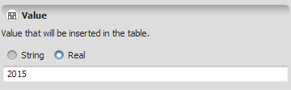


# Table Value Type

A table value is a generic holder for a single value that can be inserted into a table: it can hold either a [Real number](Real-Value-Type.html) or a [String](String-Type.html), but not both at once — which of the two it actually holds isn't fixed by the type itself, only by what was put into it.

## GUI Editor



The table value editor presents a field where either a number or a quoted string can be typed directly.

## EGO Script

Table values can be represented using the standard Dinamica EGO notation for [numbers](Real-Value-Type.html) and [strings](String-Type.html).

```
0.3456
-0.0134
3.14
0.0054
-1e-4
"string"
"string with \"quotes\""
```

## Automatic Conversions

- **Converted from**: [Real Value Type](Real-Value-Type.html), [Integer Value Type](Integer-Value-Type.html), [Non Negative Integer Value Type](Non-Negative-Integer-Value-Type.html), [Positive Integer Value Type](Positive-Integer-Value-Type.html), [Name Type](Name-Type.html), [String Type](String-Type.html), [Generic Filename Type](Generic-Filename-Type.html), [Map Filename Type](Map-Filename-Type.html), [Table Filename Type](Table-Filename-Type.html), [Lookup Table Filename Type](Lookup-Table-Filename-Type.html), and [Weights Filename Type](Weights-Filename-Type.html).
- **Converted to**: [Integer Value Type](Integer-Value-Type.html), [Non Negative Integer Value Type](Non-Negative-Integer-Value-Type.html), [Positive Integer Value Type](Positive-Integer-Value-Type.html), [Name Type](Name-Type.html), [Tuple Type](Tuple-Type.html), [Index Or Name Type](Index-Or-Name-Type.html), [Generic Filename Type](Generic-Filename-Type.html), [Map Filename Type](Map-Filename-Type.html), [Table Filename Type](Table-Filename-Type.html), [Lookup Table Filename Type](Lookup-Table-Filename-Type.html), and [Weights Filename Type](Weights-Filename-Type.html). [Real Value Type](Real-Value-Type.html) — can fail; only succeeds if the value actually holds a Real. [String Type](String-Type.html) — can fail; only succeeds if the value actually holds a String.

See [Type System](../Type-System.html#how-automatic-conversion-works) for more on this conditional-conversion pattern, and for the complete conversion reference across all types.

