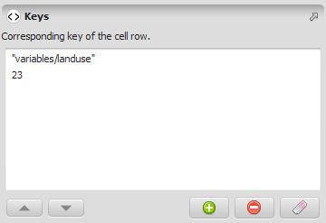


# Tuple Type

A [tuple](https://en.wikipedia.org/wiki/Tuple) is a sequence of values. Each value can be represented using double precision [floating point numbers](https://en.wikipedia.org/wiki/Floating_point), allowing the definition of integral and fractional values, or a [string](https://en.wikipedia.org/wiki/String_(computer_science)).

A Tuple's most common role is representing a table row's key — or, for a table with more than one key column, the full chain of keys identifying a row or sub-table. [Get Table Value](../functors/Get-Table-Value.html) and [Get Table Row](../functors/Get-Table-Row.html) both take one to identify which row to read from a [Table](Table-Type.html); [Get Table From Key](../functors/Get-Table-From-Key.html) and [Set Table By Key](../functors/Set-Table-By-Key.html) use one the same way to read or write an entire sub-table by its leftmost key(s); and [Get Table Row](../functors/Get-Table-Row.html)'s own output is itself a Tuple — the row's key followed by every value column, in order. See [Manipulating Tables and Lookup Tables](../Manipulating-Tables-And-Lookup-Tables.html) for the full functor catalog built around this pattern, including [Add Tuple Value](../functors/Add-Tuple-Value.html), [Get Tuple Size](../functors/Get-Tuple-Size.html), and [Get Tuple Value](../functors/Get-Tuple-Value.html) for building and reading Tuples directly.

## GUI Editor



The tuple editor lets you enter a sequence of numbers and strings.

## EGO Script

Tuples are sequences of values enclosed by \[ \]. Each value is represented by a real number or a string:

```
[
  "Amazon", 2012, 65437, 0.0342, "North"
]
```

A tuple can be any length.

## Automatic Conversions

- **Converted from**: [Real Value Type](Real-Value-Type.html), [Integer Value Type](Integer-Value-Type.html), [Non Negative Integer Value Type](Non-Negative-Integer-Value-Type.html), [Positive Integer Value Type](Positive-Integer-Value-Type.html), [Name Type](Name-Type.html), [String Type](String-Type.html), and [Table Value Type](Table-Value-Type.html).
- **Converted to**: None.

See [Type System](../Type-System.html) for the complete conversion reference across all types.

